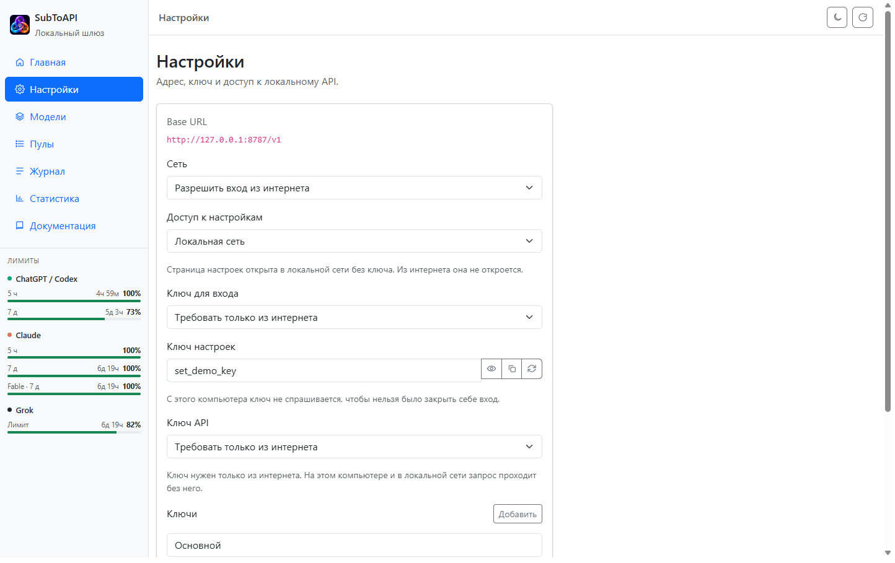
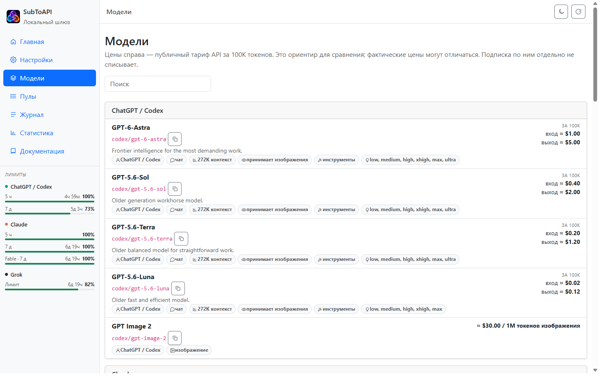
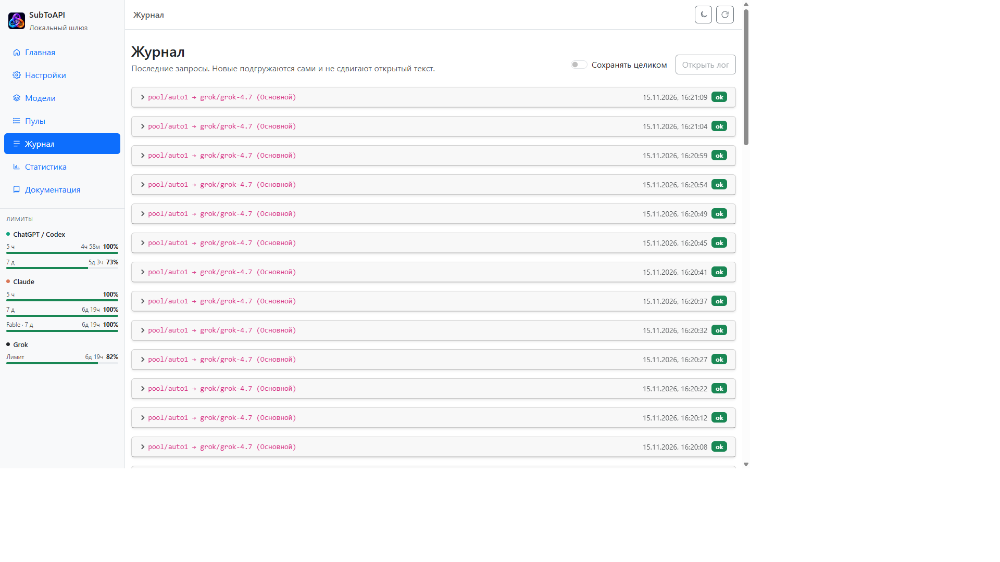
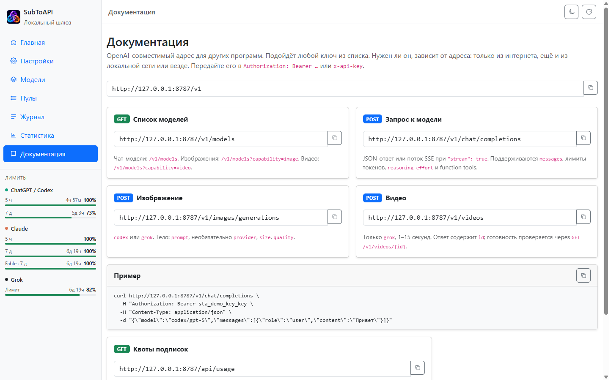

# SubToAPI

Локальный шлюз, который подключает собственные подписки и отдаёт их другим программам через OpenAI-совместимый API. Node.js на компьютере, где запускается готовая сборка, не нужен: портативный `sub-to-api.exe` уже содержит всё для старта.

Поддерживаются ChatGPT / Codex, Claude, Grok, GitHub Copilot и Google Antigravity. Каждый входит в свои аккаунты. Токены и журнал остаются на этом компьютере в папке `settings` и в репозиторий не входят.

Для клиента:

```text
Base URL: http://127.0.0.1:8787/v1
API key:  локальный ключ из интерфейса
Model:    provider/model-id или pool/имя
```

## Интерфейс

Главная показывает подключённые подписки, аккаунты и остаток лимитов.


В настройках задаются сеть, доступ к странице настроек, ключи API и порт. С адреса, где страница сама не открывается, добавьте к адресу параметр `settings` и ключ настроек: `http://адрес:порт/?settings=ключ`. Готовая ссылка есть во вкладке «Документация».



Каталог моделей приходит от провайдеров. Цены справа — публичный тариф API за 100K токенов, ориентир для сравнения, а не списание подписки.



Пул выбирает модель по остатку лимита. В клиенте указывается `pool/имя`.


Журнал хранит последние запросы шлюза: модель, токены, кеш и оценку стоимости.



Статистика считает токены по фактическим моделям и оценивает долю текущего лимита.


Документация внутри программы содержит адреса `/v1` и пример запроса.



## Запуск из исходников

Нужен Node.js 22 или новее.

```powershell
node src/cli.js
```

Откройте показанный адрес. Готовую Windows-сборку можно скачать из [релизов](https://github.com/DygDyg/sub-to-api/releases): распакуйте архив и запустите `start.bat`.

Токены и журнал хранятся в `settings/state.json` рядом с программой. При первом запуске существующий файл из `~/.sub-to-api/state.json` копируется туда.

Квоты всех подключённых провайдеров отдаёт `GET /api/usage`. Путь доступен только с этого компьютера и не требует API-ключа. Ответ кешируется на 5 минут; `?refresh=1` обновляет его, а при ошибке провайдера остаётся последняя удачная квота.

Кеш промптов живёт у провайдера, не в приложении. Claude получает точки кеша на 5 минут: system и последние блоки истории. Для Codex и Grok передайте стабильный `prompt_cache_key` в теле запроса или заголовок `x-prompt-cache-key` — один и тот же ключ на весь диалог. Попадание видно в `usage.prompt_tokens_details`.

## Claude по подписке

1. В карточке Claude нажмите **Войти** и авторизуйтесь в браузере под аккаунтом с действующим подписочным доступом к Claude Code.
2. После локального callback вернитесь в SubToAPI и нажмите **Завершить вход**. Если callback не открылся, вставьте полный callback URL вручную.
3. Модели и квоты загрузятся после входа. В клиенте используйте `claude/<model-id>` из списка `/v1/models`.

Это неофициальная интеграция на основе OAuth-протокола Claude Code. Совместимость и доступ зависят от Anthropic; перед использованием проверьте актуальные условия сервиса.
